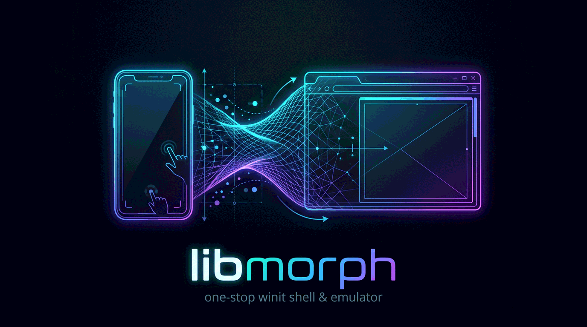

# libmorph

A windowing and device-emulation shell for [wgpu](https://github.com/gfx-rs/wgpu)
apps. One `MorphApp` runs on desktop, the web and Android.

| Host | Event loop | |
|---|---|---|
| Desktop | winit | Window sized to an emulated phone ([libdevice](https://github.com/tmzt/libdevice)); mouse becomes touch, and on macOS so do two or more trackpad fingers; corners and cutouts masked |
| Web | winit | Full-screen canvas; WebGPU, falling back to WebGL2 |
| Android | [libmobile](https://github.com/tmzt/libmobile) | `NativeActivity`; system insets become the safe area |

The wgpu device and queue persist for the whole run. Only the surface is
recreated on suspend and resume.

## Usage

```toml
[dependencies]
libmorph = { git = "https://github.com/tmzt/libmorph" }
```

```rust
use libmorph::{Frame, MorphApp, MorphContext, RenderStatus};

struct App;

impl MorphApp for App {
    fn init(_ctx: &mut MorphContext) -> Self {
        App
    }

    fn render(&mut self, ctx: &mut MorphContext, frame: &Frame<'_>) -> RenderStatus {
        // Draw to frame.view with ctx.device() and ctx.queue().
        RenderStatus::Drawn
    }
}

fn main() -> Result<(), libmorph::MorphError> {
    libmorph::run::<App>()
}
```

`RenderStatus::Skipped` says nothing changed: libmorph presents nothing and
the previous frame stays on screen. `render` has a default that draws nothing,
returns `Skipped` and logs once, so an app that constructs its own frames
writes no dead method.

Other hooks: `update`, `on_touch`, `on_hover`, `on_key`, `on_text_input`,
`on_suspend`, `on_resume`, `on_capture_ready`, `on_audio`, `on_permissions`,
`on_camera`, `on_media`, `on_open_url`, `on_intent`, `on_service`,
`on_low_memory` and `on_trim_memory`. Every one has a default body, so an app
writes only the ones it uses. `MorphContext` also provides the safe area,
scale factor, surface size and format, the device spec, audio, the app's data
and cache directories, the clipboard, the secure store and key store,
`open_link`, `request_permissions` and `exit`. The rustdoc documents each one,
and which hosts answer it.

```sh
cargo run --example touch -- --device iphone_15
cargo run --example tone
```

### Owning the frame

By default libmorph acquires the surface texture, calls `update` and
`render`, and presents. An app that wants the frame says so with one const,
and libmorph stops doing any of it:

```rust
use libmorph::{AcquireError, MorphApp, MorphContext, Owned};

impl MorphApp for Game {
    const OWNS: Owned = Owned::FRAME;

    fn construct_frame(&mut self, ctx: &mut MorphContext) {
        let frame = match ctx.acquire_frame() {
            Ok(frame) => frame,
            // Nothing to draw into this iteration.
            Err(AcquireError::NotReady | AcquireError::Outdated) => return,
            Err(error) => {
                log::warn!("acquire: {error}");
                return;
            }
        };
        // Draw into frame.view with ctx.device() and ctx.queue(), then:
        ctx.present_frame(frame);
    }
}
```

`render` is never called. `update` still is, so an app may keep its
simulation there or do everything in `construct_frame`.

**One rule: a frame is presented or dropped before `construct_frame`
returns.** libmorph reconfigures the surface between iterations, and
Android takes the window back synchronously when it goes away, so an image
held across either is stale at best. To skip a frame, do not acquire one -
nothing is presented and the previous frame stays on screen.

What stays libmorph's: the device, queue and adapter; the window and its
creation, resize and destruction; the surface and its configuration; every
event; and every JNI call. The frame is the most an app can own, because the
surface comes from the window the Android loop owns.

`Owned::of(&[..])` combines flags in a const. There is no `BitOr`: a trait
impl cannot be `const` on stable Rust, and `OWNS` is always a const.

### Configuring the surface

An app that owns the frame is also handed the surface configuration libmorph
would have used, and returns the one to apply. It is called at every attach -
the first window, and again after a rotation, a resume or a lost surface:

```rust
fn wgpu_config(
    default: wgpu::SurfaceConfiguration,
    caps: &wgpu::SurfaceCapabilities,
) -> wgpu::SurfaceConfiguration {
    if caps.present_modes.contains(&wgpu::PresentMode::Mailbox) {
        return wgpu::SurfaceConfiguration {
            present_mode: wgpu::PresentMode::Mailbox,
            ..default
        };
    }
    default
}
```

libmorph sets `width` and `height` after it returns, since it knows the
window's size. A managed app's one surface knob is `const SRGB_SURFACE:
bool`, which prefers a non-sRGB surface for shaders that gamma-encode
themselves.

### Device limits

libmorph brings up the adapter, device and queue itself: the primary backends
on desktop, Vulkan or GL on Android, WebGPU falling back to WebGL2 on the web.
It starts from wgpu's downlevel defaults - the WebGL2 downlevel defaults on any
GL adapter, which includes older Android devices - with the texture sizes
raised to what the adapter actually offers.

An app that needs more says so before `init`:

```rust
fn limits(base: &wgpu::Limits) -> LimitsRequest {
    let required = wgpu::Limits { max_storage_buffers_per_shader_stage: 8, ..base.clone() };
    LimitsRequest { preferred: required.clone(), required }
}
```

`required` is never lowered. Any field the adapter cannot meet fails bring-up
with `GpuError::Limits`, which lists each field with what was asked for and
what is available. `preferred` is granted as far as the adapter allows, and
`ctx.limits()` returns what was actually granted, so an app can look at it
rather than assume.

### Input and emulation (desktop)

The window is sized from the emulated device's pixels, shrunk to fit the
display unless `--morph-window-scale <n>` asks for an exact multiple. The scale
factor the app sees is the device's own pixel ratio adjusted for that shrink,
independent of the host monitor's DPI; the safe area, the overlay and
`px_per_mm()` follow it. The overlay masks the device's rounded corners and
draws its cutouts, so a layout can be checked against the real obstructions.

Mouse events become the same touch events Android sends, so `on_touch` behaves
the same on both hosts:

- the left button is a single finger, with the id `u64::MAX`;
- moving with no button held is `on_hover`, not a touch;
- a held touch is cancelled once when the pointer leaves the window, and
  nothing more is reported until the next press;
- pressure comes from Android, and on macOS from Force Touch while the button
  is held.

More than one finger comes only from real touch hardware: a touchscreen, or the
macOS trackpad. A trackpad session starts when two or more fingers are on the
pad with the cursor over the window, reports every finger with an id of its own
until the last one lifts, and holds the mouse off while it runs - with one
finger, the pad is still the mouse. Losing focus or suspending cancels the
fingers.

### Options (desktop)

| Option | |
|---|---|
| `--device <name>` | Emulated device: `galaxy_s24` (default), `iphone_15` |
| `--device-<field> <value>` | Override one field, e.g. `--device-width 720` |
| `--morph-fallback-adapter` | Software GPU adapter |
| `--morph-no-overlay` | Don't mask corners and cutouts |
| `--morph-help` | List all options |
| `--morph-script <path>` | Run a script headless and write screenshots (`script` feature) |
| `--morph-out <dir>` | Output directory for `--morph-script` |
| `--morph-trackpad <physical\|fit\|off>` | macOS: two or more trackpad fingers are touches, at the device's real scale around the cursor (`physical`, default), across the whole screen (`fit`), or not at all |
| `--morph-window-scale <fit\|n>` | Window size as a multiple of the device's pixels; `fit` (default) shrinks it to fit the display |

Other arguments reach the app through `ctx.args()`.

### Scripted runs

A script is a text file with one command per line:

```
frames 30
screenshot idle
drag 1 100 400 900 1800 20
screenshot dragged
key escape
```

Commands: `fps`, `frames`, `touch`, `tap`, `drag`, `hover`, `key`,
`screenshot`, `geometry`, `suspend`, `resume`, `exit`. The run has no window
and a fixed frame time. `geometry <width> <height>` is the window reporting a
new size, as it does when the device turns; it is accepted while suspended,
where it sets the size the next `resume` attaches at. Screenshots are PNG files, and `run.json` lists them. Output
goes to `out/morph/YYYYMMDD_NN_<script name>/` unless `--morph-out` is
given. The same script on the same machine writes the same bytes.

```sh
cargo run --example touch --features script -- --morph-script examples/scripts/touch.morph
```

From Rust, including tests: `libmorph::script::run::<App>(&script, run)`.

## Lifecycle

The device and queue live for the whole run. The surface does not: it exists
only while there is a window, and on Android the window goes away whenever the
app leaves the screen.

**Android.** A new window creates and configures the surface; on the first one
libmorph also brings up the adapter, device and queue and calls `init`. When
the window goes away the surface is dropped at once, because Android takes it
back synchronously, and then `on_suspend` is called. A resume with a window
calls `on_resume`. New system insets update the safe area. Each tick is
`update` then `render`. Shutdown calls `on_suspend` only if the window has not
already caused it. Back and Escape reach `on_key` on their first press, and the
status the app returns also answers that key's repeats and its release, since
Android acts on Back when it comes up.

**Desktop.** The window and surface are created on resume and dropped on
suspend. Closing the window, `ctx.exit()`, a failure and the event loop ending
all go through the same shutdown.

**Web.** Bring-up is asynchronous, and nothing is drawn until it has finished.

`on_suspend` and `on_resume` are called once per transition, and every exit
calls `on_suspend` once unless the app is already suspended.

## Features

| Feature | |
|---|---|
| `audio` (default) | Sound playback and streaming sources through cpal (libmobile's cpal on Android) |
| `audio-cpal` | Re-exports cpal as `libmorph::cpal`, with the output device and stream config |
| `script` | Scripted headless runs with PNG screenshots (desktop) |
| `web` | wasm32 support; required on that target |
| `mobile` | Android support through libmobile; required on that target |
| `mobile-google-auth` | libmobile's Sign in with Google |
| `mobile-camera` | libmobile's photo capture (to be replaced, see below) |
| `mobile-media-request` | `ctx.media_request` through libmobile's chooser (gallery, files, an optional camera entry) or the Photo Picker; answers in `MorphApp::on_media`. The web uses a file input; the desktop answers `Unsupported` |
| `mobile-foreground-service` | `libmorph::service`: a foreground service with its notification, controlled from any thread, and its events in `MorphApp::on_service` |
| `mobile-system-events` | `libmorph::system_events` on Android: visibility, focus, the service, the network and Doze |
| `mobile-battery` | `libmorph::battery`: battery optimization and app sleeping |
| `mobile-clipboard` | The clipboard's text on Android, for `ctx.clipboard_text`, `ctx.clipboard_has_text` and `ctx.set_clipboard_text` |
| `mobile-secure-store-no-strongbox` | Keeps the secure store's key in the TEE only, never StrongBox. Negative, so turning default features off cannot turn StrongBox off; for apps, not libraries |
| `secure-store` | `ctx.secure_store()` and `ctx.key_store()`: named secrets and adapter keys encrypted at rest, through libmobile's Keystore stores on Android and libdevice's login Keychain on macOS |
| `tokio` | `system_events::subscribe_tokio`, on Android and off it; nothing needs a tokio runtime to send |

## Android

On Android, libmorph is a wrapper around [libmobile](https://github.com/tmzt/libmobile).
Everything that touches the platform (the NDK, AAudio, Kotlin plugins,
runtime permissions) is built in libmobile first, with an example there
that uses it. libmorph then wraps it in an API that is the same on every
host and handles the app's lifecycle around it. For example, audio capture
with input presets is libmobile's `CaptureStream`, and libmorph's
`CaptureMode` maps onto it.

The desktop follows the same rule with [libdevice](https://github.com/tmzt/libdevice):
desktop platform services, such as the macOS Keychain behind the secure
store, are built there first. Where both crates provide a service, they
expose the same API, and libmorph wraps them. libmorph's own code is what
it exists for: wgpu, the window and event loop, device emulation and input,
audio through cpal off Android, and scripted runs.

The app crate is a `cdylib`, and `build.rs` generates its Gradle project:

```toml
[lib]
crate-type = ["cdylib"]

[dependencies]
libmorph = { git = "https://github.com/tmzt/libmorph", features = ["mobile"] }

[build-dependencies]
libmorph-build = { git = "https://github.com/tmzt/libmorph" }
```

```rust
// build.rs
fn main() {
    libmorph_build::gradle_project("com.example.app")
        .generate()
        .expect("gradle project");
}
```

```rust
// src/lib.rs
#[unsafe(no_mangle)]
fn android_main(app: libmorph::AndroidApp) {
    libmorph::run_android::<App>(app);
}
```

```sh
cargo build --release --target aarch64-linux-android --lib
gradle -p target/aarch64-linux-android/release/gradle/<package> assembleDebug
```

### Pipeline cache

Android drivers do not keep compiled pipelines between launches. On
Android with Vulkan, libmorph keeps a `wgpu::PipelineCache` for the app at
`<data_dir>/libmorph/<key>.bin`: loaded before `init`, saved after `init`,
on suspend and on exit. Pass it to the pipelines that should be kept:

```rust
device.create_render_pipeline(&wgpu::RenderPipelineDescriptor {
    // ...
    cache: ctx.pipeline_cache(),
});
```

`ctx.pipeline_cache()` is `None` everywhere else (desktop, the web,
Android on GL), which is what `cache` takes when nothing is cached.

## Limitations

- No native iOS. iPhone geometry can be emulated on desktop.
- Device insets in libdevice are estimates, not measured on hardware.

## Tools

- `scripts/make_icon.py`: Android launcher icons (legacy, round, adaptive
  and monochrome) from one square image, with a contact sheet. The source is
  a PNG with transparency, or any image (a JPEG, say) on a flat colour that
  `--key` removes; `--crop` picks a square region of a larger image. Needs Python 3 with Pillow and numpy:

  ```sh
  python3 -I scripts/make_icon.py --source art.png --out icon/ \
      [--crop X,Y,W,H] [--key RRGGBB|auto] [--key-tolerance T] [--background RRGGBB] \
      [--hue DEG] [--full-bleed] [--no-monochrome]
  ```

  Copy `icon/android/res/` into the app's resources until libmorph-build
  generates icons itself.

## Development

Contributor and agent rules are in [AGENTS.md](AGENTS.md); planned work is
logged in [CHANGES.md](CHANGES.md).

## License

Licensed under either of

- Apache License, Version 2.0 ([LICENSE-APACHE](LICENSE-APACHE) or
  <http://www.apache.org/licenses/LICENSE-2.0>)
- MIT license ([LICENSE-MIT](LICENSE-MIT) or <http://opensource.org/licenses/MIT>)

at your option.

### Contribution

Unless you explicitly state otherwise, any contribution intentionally submitted
for inclusion in the work by you, as defined in the Apache-2.0 license, shall be
dual licensed as above, without any additional terms or conditions.

## Architectural decisions

| Document | Date | Status | Decision |
|---|---|---|---|
| [Camera view and capture](docs/design/20261014_01_CAMERA_VIEW_AND_CAPTURE_PLAN.md) | 2026-10-14 | Hold | Split the camera into `camera-view` (live preview texture) and `camera-capture` (still photo), with `camera-stream` reserved, replacing `mobile-camera`. Desktop uses nokhwa, the web `getUserMedia`, and Android the NDK camera. The decisions are confirmed but the plan is not approved for implementation. |
| [libmorph-build](docs/design/20261014_02_LIBMORPH_BUILD_CRATE_PLAN.md) | 2026-10-14 | Implemented | A `crates/libmorph-build` crate re-exports `libmobile::gradle` with libmorph's `links` key, so Android apps no longer name libmobile. The repository becomes a workspace. |
| [Shell input and lifecycle](docs/design/20261014_03_SHELL_INPUT_AND_LIFECYCLE_PLAN.md) | 2026-10-14 | Implemented | Touch pressure, hover, keys, `exit()` with one `on_suspend` per exit, `data_dir`, and `SRGB_SURFACE`. Adds `Touch::pressure` and `libmobile::android::finish`. All steps are done and the owner accepted them. |
| [Scripted runs and PNG capture](docs/design/20261014_04_SCRIPTED_RUNS_AND_PNG_CAPTURE_PLAN.md) | 2026-10-14 | Implemented | Headless desktop runs driven by a `.morph` script of English commands (touches, taps, drags, keys, screenshots) with a fixed frame time, PNG screenshots through the `png` crate, and output in `--morph-out` or `out/morph/YYYYMMDD_NN_<stem>/`. Behind the optional `script` feature. All steps are done and the owner accepted them. |
| [App-requested device limits](docs/design/20261014_05_APP_LIMITS_REQUEST_PLAN.md) | 2026-10-14 | Implemented | Apps return a `LimitsRequest` (required and preferred `wgpu::Limits`) from `MorphApp::limits` before bring-up. Required limits the adapter lacks fail with `GpuError::Limits`; `GpuError` becomes `#[non_exhaustive]`. All steps are done. |
| [Mac trackpad fingers as touches](docs/design/20261015_01_MAC_TRACKPAD_TOUCH_PLAN.md) | 2026-10-15 | Implemented | On macOS, two or more trackpad fingers become `Touch` events with their own ids, read from AppKit's `NSTouch` and mapped at phone scale around the cursor using libdevice's pixel density. One finger stays the mouse. The desktop window is fitted to the display. All steps are done and the owner checked them on a MacBook Pro. |
| [Audio output device and streaming sources](docs/design/20261016_01_AUDIO_DEVICE_AND_SOURCES_PLAN.md) | 2026-10-16 | Implemented | Apps add streaming sources, callbacks that fill part of each output buffer on the audio thread, mixed with `Sound` voices, plus a master volume. An `audio-cpal` feature re-exports cpal and exposes the output device as `DeviceTrait`. libmobile owns cpal on Android. All steps are done; released in 0.2.0. |
| [Persistent pipeline cache](docs/design/20261016_02_PIPELINE_CACHE_PLAN.md) | 2026-10-16 | Implemented | On Android with Vulkan, libmorph requests `PIPELINE_CACHE`, creates one `wgpu::PipelineCache` from data kept in the app's data directory, offers it as `ctx.pipeline_cache()`, and saves it after `init`, on suspend and on exit. Elsewhere it is `None`. All steps are done; released in 0.2.1, and on a Galaxy S23 a cached pipeline builds in 34 ms instead of 1.3 s. |
| [Audio capture and the audio_setup hook](docs/design/20261022_01_AUDIO_CAPTURE_PLAN.md) | 2026-10-22 | In implementation | A `MorphApp::audio_setup` hook, called before audio opens, asks for a capture stream (and can turn output off). Captured blocks go to sinks on the audio input thread as `f32` with a frame count and capture time. An `audiocapture` example writes `.au` files named by millisecond timestamps. Requested and being built by the owner's instruction. |
| [Runtime permissions for apps](docs/design/20261022_02_APP_PERMISSIONS_PLAN.md) | 2026-10-22 | In implementation | Apps ask for any runtime permission with `ctx.request_permissions`, get answers in `MorphApp::on_permissions`, and check `permission_granted` and `should_show_rationale`; off Android there are none to ask for. The Android runner routes answers by request id, replacing the capture code's flag. Done and checked on the S23 and macOS; released in 0.3.1 with libmobile 0.2.1 and libdevice 0.1.1. |
| [Secure store on every host](docs/design/20261022_03_SECURE_STORE_PLAN.md) | 2026-10-22 | Implemented | A `secure-store` feature gives `ctx.secure_store()`, named byte blobs encrypted at rest: Android through libmobile's Keystore store, the macOS Keychain on the desktop, memory in scripted runs. Requested by handlr for its Noise key. The desktop backend moved to libdevice. Done and checked on the S23 and macOS; released in 0.3.1. |
| [Opaque keys in the secure store](docs/design/20261022_04_OPAQUE_KEYS_PLAN.md) | 2026-10-22 | Superseded (by [Key store for keying material](docs/design/20261022_05_KEY_STORE_PLAN.md)) | Adapter keys sealed in the secure store, with handles and a libmorph bridge. Replaced, before implementation, by the simpler key store plan. |
| [Key store for keying material](docs/design/20261022_05_KEY_STORE_PLAN.md) | 2026-10-22 | Superseded (by [Key store for keying material](docs/design/20261022_06_KEY_STORE_PLAN.md)) | The first form of the simplified key store, with three amendments. Restated as one document before implementation. |
| [Key store for keying material](docs/design/20261022_06_KEY_STORE_PLAN.md) | 2026-10-22 | Implemented | One small engine file, identical in libmobile and libdevice, as free functions over a thin per-platform `Vault`. The store generates and seals an adapter's key, returns its public value, and lends the key for one call (`with_key`). Flags are enforced by the platform and refused when not enforced. The Android blob store moves to the Application context with it. libmorph re-exports the active engine. Done and checked on the S23 and macOS; released in 0.3.1 with libmobile 0.2.1 and libdevice 0.1.1. |
| [Opening the app from a URL scheme](docs/design/20261022_07_URL_SCHEMES_PLAN.md) | 2026-10-22 | Implemented | Generated Android projects declare custom URL schemes (`Project::url_scheme`, through libmorph-build), and `MorphApp::on_open_url` gets each URL after `init`, in order, from a cold start or while running, built on libmobile's existing intent bridge. URLs are never logged past their path. macOS needs an app bundle and is left to a later plan. Requested by handlr for its pairing links; libmobile 0.2.2 implements the schemes and the redaction; libmorph wraps them; released in libmorph 0.3.2. The camera scan is left to handlr's check. |
| [Foreground service and system events](docs/design/20261023_01_FOREGROUND_SERVICE_PLAN.md) | 2026-10-23 | In implementation | libmobile generates an Android foreground service, declared with its types from the build script and controlled from Rust on any thread. It also gives system events (foreground and background, the service, network changes, Doze) as a runtime-agnostic `Stream` that keeps working while the UI is paused. libmorph wraps both, and the desktop reports unsupported. The plan states what the service does and does not guarantee. Requested by handlr for its background link; approved. libmobile 0.2.3 implements it under its own plan, with Termux-style notification controls; libmorph wraps it, with a new `MorphApp::on_service` hook (step 5 under way). |
| [Opening a link in another app](docs/design/20261023_02_OPEN_LINK_PLAN.md) | 2026-10-23 | Implemented | `MorphContext::open_link(url)` opens an http or https link in the browser on every host, wrapping libmobile on Android and libdevice on the Mac, with a new tab on the web and a redacted log line in scripted runs. Requested by handlr for repowiki links; libmobile 0.2.3 and libdevice 0.1.2 implement it, and libmorph wraps them; released in libmorph 0.4.0. |
| [Persistent storage and cache directories on every host](docs/design/20261023_03_APP_STORAGE_PLAN.md) | 2026-10-23 | Implemented | `MorphContext::data_dir()` becomes a private per-app directory on every host, with a new `cache_dir()`, created before `init`, from libmobile on Android and libdevice on the desktop (named by a new `MorphApp::APP_ID`), inside the output in scripted runs, and `None` on the web (a minor bump). Requested by the owner through handlr; libmobile 0.2.3 and libdevice 0.1.2 give the directories, and libmorph wraps them; released in libmorph 0.4.0. |
| [Telling the app about memory pressure](docs/design/20261024_01_MEMORY_PRESSURE_PLAN.md) | 2026-10-24 | Implemented | In two stages: `MorphApp::on_low_memory` from libmobile's existing low-memory event (and a `low-memory` script command), then `on_trim_memory(TrimLevel)` once libmobile forwards Android's trim levels. Requested by handlr on the owner's instruction; approved, and stage 1 under way. Released in libmorph 0.4.1. |
| [The device's vendor, make and model](docs/design/20261024_02_DEVICE_INFO_PLAN.md) | 2026-10-24 | Implemented | `MorphContext::build_info()`: the Android device's vendor, make and model from libmobile's `build_info()`, and nothing that identifies the unit or its owner; `None` on desktop, the web and in scripted runs. Named `build_info`, as libmobile's call is; `device()` returns the `DeviceSpec`. Requested by the owner through handlr; awaiting the owner's review. Released in libmorph 0.4.1. |
| [App icons through libmorph-build](docs/design/20261024_03_APP_ICON_PLAN.md) | 2026-10-24 | Implemented | libmorph-build turns on libmobile's host-only `icons` feature, so `gradle_project(id).icon(Icon::png(..))` makes the Android launcher, round, adaptive and monochrome icons from a master PNG; desktop icons later. Requested by the owner through handlr; approved. Released in libmorph-build 0.2.5. |
| [Alert notifications and notification taps](docs/design/20261024_04_NOTIFICATIONS_PLAN.md) | 2026-10-24 | Draft | `libmorph::notify` posts and cancels alert notifications on the app's own channels, `MorphApp::on_notify` and `ServiceEvent::Tapped` say which notification was tapped (by a tag in `NotificationContent`), and updating the ongoing notification while suspended is documented and checked; built in libmobile first. Requested by handlr with the owner's approval to ask; approved. |
| [The system's dark mode](docs/design/20261024_05_DARK_MODE_PLAN.md) | 2026-10-24 | Draft | `MorphContext::dark_mode()` and `MorphApp::on_dark_mode`: Android's night mode from libmobile, the desktop's and browser's appearance from winit, and a `dark-mode` script command; the system bars follow the app's colours. Requested by handlr with the owner's approval to ask; approved. |
| [Text input and the soft keyboard](docs/design/20261024_06_TEXT_INPUT_PLAN.md) | 2026-10-24 | In implementation | `start_text_input`/`stop_text_input`, `MorphApp::on_text_input` (`Changed`, `Action`, `Dismissed`) and `keyboard_inset()`: libmobile's keyboard bridge on Android with new options, winit's IME and keys on the desktop with paste from libdevice, and script commands. Requested by handlr with the owner's approval to ask; approved. |
| [Camera capture and QR scanning for apps](docs/design/20261028_01_CAMERA_CAPTURE_AND_QR_PLAN.md) | 2026-10-28 | Draft | `ctx.camera()` and `MorphApp::on_camera` on every host: one still frame (`mobile-camera-capture`) and QR scanning with auto zoom, screen exposure and app-driven pinch zoom (`mobile-camera-qr`) through libmobile's NDK camera, which asks for CAMERA only on first use; `Unsupported` on desktop and the web, script commands for headless tests. Proposed; awaiting the owner. |
| [Asking the user for a photo or video, on every host](docs/design/20261028_02_MEDIA_REQUEST_PLAN.md) | 2026-10-28 | In implementation | `ctx.media_request` and `MorphApp::on_media`: libmobile's chooser with an optional camera entry on Android (`mobile-media-request`), a hidden file input on the web, `Unsupported` on the desktop for now, and script commands for headless tests. Approved; built as 0.5.2 on libmobile 0.3.4, its browser and S23 checks open. |
| [The clipboard's text on every host](docs/design/20261028_03_CLIPBOARD_PLAN.md) | 2026-10-28 | In implementation | `MorphContext::clipboard_text` and `clipboard_has_text`: libmobile's `clipboard` on Android (`mobile-clipboard`), libdevice's on macOS, `None` elsewhere and in scripted runs; read only. Being built on the owner's approval. |
| [Writing text to the clipboard on every host](docs/design/20261029_01_CLIPBOARD_WRITE_PLAN.md) | 2026-10-29 | In implementation | `MorphContext::set_clipboard_text` returning `ClipboardWrite::SystemNotice` (Android 13+, the app shows no notice of its own) or `Silent`, and `clipboard_can_write`: libmobile's write on Android (`mobile-clipboard`), libdevice's on macOS, logged only in scripted runs, `Unsupported` elsewhere. Requested for RoundTwo's Copy buttons, its first user; approved and being built on libmobile 0.3.5 and libdevice 0.1.3, for 0.5.3. |
| [Audio streams that recover after a resume or a lost device](docs/design/20261029_02_AUDIO_STREAM_RECOVERY_PLAN.md) | 2026-10-29 | In implementation | When starting capture or output again on resume fails (the S23's `InvalidState`), the stream is lost, or it stalls for 1 s, libmorph reopens it with the same mode, format, sinks and mixer, four attempts at 0/250/1000/3000 ms, then reports `Failed`; apps learn through a new `MorphApp::on_audio` (`Interrupted`, `Restored`, `Failed`), `capture_state()`/`output_state()` and `restart()`, with `on_capture_ready` still once per run. For 0.5.4, additive; RoundTwo is the first user. Approved, with the plan's defaults for its open questions; being built. |
| [An intent's own extras, delivered whole](docs/design/20261104_01_INTENT_EXTRAS_PLAN.md) | 2026-11-04 | Implemented | `MorphApp::on_intent` hands the app the whole intent libmobile already carries - action, data URI, every extra as a key and a string, and whether it reached a running instance - where the Android runner kept only `intent.data` and discarded the rest, so `am start --es <key> <value>` could not reach an app at all. A script verb `intent <key>=<value>` delivers the same headlessly. `on_open_url` is unchanged and a `VIEW` intent calls both, so the addition is strictly additive; asked for by sigilweaver, which sends a scene's Markdown as a base64 extra because `args()` is empty on Android. |
| [The app runs off the loop thread](docs/design/20261105_01_THE_APP_RUNS_OFF_THE_LOOP_THREAD_PLAN.md) | 2026-11-05 | Draft | Each thread runs its own event loop and a routing atomic bitset says which loop gets which event class - lifecycle and input on the loop thread by default, with a sim tick and a scheduled draw available through the builder. JNI stays on the loop thread, so nothing needs attaching to the VM; teardown is an ordinary stop event the draw thread quiesces on, and rotation is teardown then setup with no special path. Draft, and its own premise is corrected in an amendment: a multi-second frame is a stall or a measurement artefact rather than a condition to design around, so this is justified by an app that cannot be measured and not by the number that prompted it. |
| [An app may present its own frames](docs/design/20261105_02_AN_APP_MAY_PRESENT_ITS_OWN_FRAMES_PLAN.md) | 2026-11-05 | Superseded (by [The app configures what libmorph manages, and may construct its own frames](docs/design/20261105_03_THE_APP_CONFIGURES_WHAT_LIBMORPH_MANAGES_PLAN.md)) | `MorphApp::drawing()` returning `Drawing::Own` would have stopped libmorph acquiring and presenting, calling `present` instead. Superseded before implementation: it made ownership the shape of the choice rather than one field of a config, so it had no place for the surface format, present mode and frame latency an app wants under either mode, and it could not say what happened to the audio, camera and media pumps in `Shell::draw` when the frame was the app's. Its opt-out is carried forward as `DrawingMode::ConstructFrame`. |
| [The app configures what libmorph manages, and may construct its own frames](docs/design/20261105_03_THE_APP_CONFIGURES_WHAT_LIBMORPH_MANAGES_PLAN.md) | 2026-11-05 | Superseded (by [OWNS - an app declares the subsystems it takes, and render says whether to present](docs/design/20261105_04_OWNS_AND_THE_RENDER_STATUS_PLAN.md)) | A first callback, `MorphApp::configure`, runs before anything opens and returns a `MorphAppConfig` of per-subsystem preferences, `None` meaning no opinion. `DrawingConfig` carries the surface format, present mode and frame latency, applied at every surface configure under both modes, and a `mode`: `Managed` (libmorph acquires, calls `render`, presents, as today) or `ConstructFrame` (the app does, through `ctx.acquire` and `ctx.present`; `render` stays required and is not called). Configuration and ownership are two axes; a managed subsystem is opened, pumped and called and an owned one is none of those; a register computed once from the config is read inside each subsystem's entry point; the pumps leave `Shell::draw` for a per-iteration `Shell::iterate`. Audio is left for its own plan. libdevice and libmobile are pinned by tag (Rule 5.5). Targets 0.7.0, not 1.0, because the config's shape is the open question. Superseded before implementation: a returned config had to be stored and read back through a register, and its surface fields mirrored `wgpu::SurfaceConfiguration` field by field, which would make libmorph track wgpu's API and bump for it. Its frame, its one rule, its version reasoning and its pinning by tag are carried forward; `configure` and the register become an associated const. Supersedes 20261105_02. |
| [OWNS - an app declares the subsystems it takes, and render says whether to present](docs/design/20261105_04_OWNS_AND_THE_RENDER_STATUS_PLAN.md) | 2026-11-05 | In implementation | One associated const, `MorphApp::OWNS`, of a hand-rolled `Owned` flags type, by which an app declares the subsystems it takes from libmorph; `Owned::FRAME` is the only flag built and it turns off libmorph's acquire, draw and present in favour of `construct_frame`, `ctx.acquire_frame` and `ctx.present_frame`, with the surface configured through a `wgpu_config` hook that takes and returns wgpu's own `SurfaceConfiguration` rather than mirroring its fields. A const has no place in the call sequence, so nothing is stored and the branch folds at compile time. And a `RenderStatus` return from `render`, by which a managed app says whether the frame needs presenting - which is what lets `render` have a default body, so an owning app writes no dead method, and a missing one logs once instead of presenting an untouched texture. `FRAME` is the ceiling an app can own, because the surface comes from the window libmobile's loop owns. `AUDIO`, `CAMERA` and `MEDIA` are named as the next flags and not built; adding one is strictly additive. 0.7.0, not 1.0: `render`'s signature breaks, and the trait's applet shape is provisional. Approved and being built, from step 1; supersedes 20261105_03. |
| [Releasing the GPU in the background](docs/design/20261111_01_RELEASING_THE_GPU_IN_THE_BACKGROUND_PLAN.md) | 2026-11-11 | Superseded (by [The GPU in the types](docs/design/20261111_02_THE_GPU_IN_THE_TYPES_PLAN.md)) | An associated const, `MorphApp::GPU_IN_BACKGROUND`, `Keep` by default or `Release { after }`: after `after` without a surface, or at once under a `Background` trim or low memory, libmorph calls `on_gpu(GpuEvent::Release)`, drops its own GPU objects and the device, queue and adapter, and on the next window requests a device with the same limits and calls `on_gpu(Restored)` before `on_resume`; on the desktop an occluded or minimised window stops frames for a releasing app. `MEMORY_HINTS` passes wgpu's own hints, and the allocator report is logged at each step. Additive, for 0.7.2. Asked for because flankr's companion holds its device in the background while other GPU apps run out of memory; superseded before implementation, because the owner chose to put the device's absence in the types rather than panic. |
| [The GPU in the types](docs/design/20261111_02_THE_GPU_IN_THE_TYPES_PLAN.md) | 2026-11-11 | Draft | The background release, with the device's absence in the types: `HostContext` carries everything but the GPU and is what the ten callbacks that can arrive with no device receive (`on_service`, `on_intent`, `on_audio`, the trims and the rest); `MorphContext` derefs to it, adds `device()`, `queue()`, `limits()` and `adapter_info()`, and exists only with a device, so `init`, `update`, `render`, input and the lifecycle keep their calls unchanged. Then `GPU_IN_BACKGROUND` (`Keep`, or `Release { after }`), one `on_gpu` hook, desktop occlusion, `MEMORY_HINTS` and the allocator report. Chosen over `Option` accessors on a review of every dependent, whose 142 accessor calls all sit where a device exists. A break, 0.8.0; flankr's companion adopts it first. Supersedes 20261111_01. |
