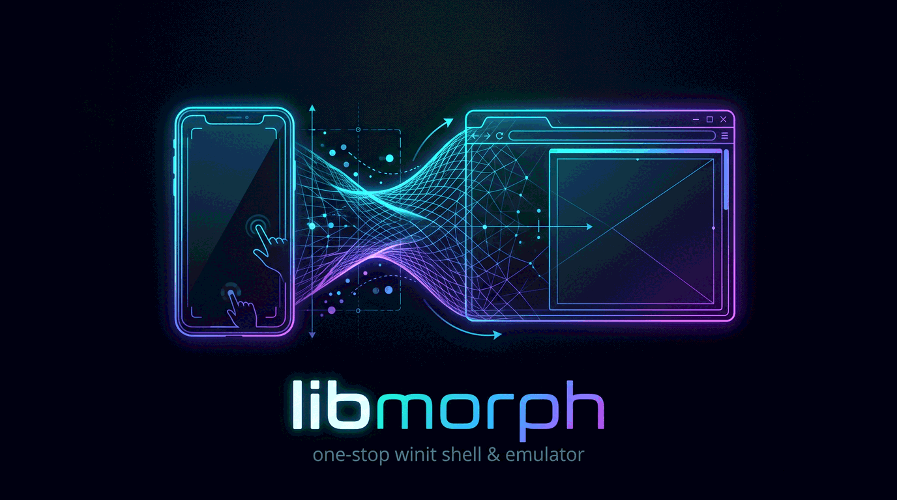

# libmorph

A windowing and device-emulation shell for [wgpu](https://github.com/gfx-rs/wgpu)
apps. One `MorphApp` runs on desktop, the web and Android.

| Host | Event loop | |
|---|---|---|
| Desktop | winit | Window sized to an emulated phone ([libdevice](https://github.com/tmzt/libdevice)); mouse becomes touch, and on macOS so do two or more trackpad fingers; corners and cutouts masked |
| Web | winit | Full-screen canvas; WebGPU, falling back to WebGL2 |
| Android | [libmobile](https://github.com/tmzt/libmobile) | `NativeActivity`; system insets become the safe area |

The wgpu device and queue persist for the whole run. Only the surface is
recreated on suspend and resume.

## Usage

```toml
[dependencies]
libmorph = { git = "https://github.com/tmzt/libmorph" }
```

```rust
use libmorph::{Frame, MorphApp, MorphContext};

struct App;

impl MorphApp for App {
    fn init(_ctx: &mut MorphContext) -> Self {
        App
    }

    fn render(&mut self, ctx: &mut MorphContext, frame: &Frame<'_>) {
        // Draw to frame.view with ctx.device() and ctx.queue().
    }
}

fn main() -> Result<(), libmorph::MorphError> {
    libmorph::run::<App>()
}
```

Other hooks: `update`, `on_touch`, `on_suspend`, `on_resume`. `MorphContext`
also provides the safe area, scale factor, surface size and format, the device
spec and audio.

```sh
cargo run --example touch -- --device iphone_15
cargo run --example tone
```

### Options (desktop)

| Option | |
|---|---|
| `--device <name>` | Emulated device: `galaxy_s24` (default), `iphone_15` |
| `--device-<field> <value>` | Override one field, e.g. `--device-width 720` |
| `--morph-fallback-adapter` | Software GPU adapter |
| `--morph-no-overlay` | Don't mask corners and cutouts |
| `--morph-help` | List all options |
| `--morph-script <path>` | Run a script headless and write screenshots (`script` feature) |
| `--morph-out <dir>` | Output directory for `--morph-script` |
| `--morph-trackpad <physical\|fit\|off>` | macOS: two or more trackpad fingers are touches, at the device's real scale around the cursor (`physical`, default), across the whole screen (`fit`), or not at all |
| `--morph-window-scale <fit\|n>` | Window size as a multiple of the device's pixels; `fit` (default) shrinks it to fit the display |

Other arguments reach the app through `ctx.args()`.

### Scripted runs

A script is a text file with one command per line:

```
frames 30
screenshot idle
drag 1 100 400 900 1800 20
screenshot dragged
key escape
```

Commands: `fps`, `frames`, `touch`, `tap`, `drag`, `hover`, `key`,
`screenshot`, `suspend`, `resume`, `exit`. The run has no window and a fixed
frame time. Screenshots are PNG files, and `run.json` lists them. Output
goes to `out/morph/YYYYMMDD_NN_<script name>/` unless `--morph-out` is
given. The same script on the same machine writes the same bytes.

```sh
cargo run --example touch --features script -- --morph-script examples/scripts/touch.morph
```

From Rust, including tests: `libmorph::script::run::<App>(&script, run)`.

## Features

| Feature | |
|---|---|
| `audio` (default) | Sound playback and streaming sources through cpal (libmobile's cpal on Android) |
| `audio-cpal` | Re-exports cpal as `libmorph::cpal`, with the output device and stream config |
| `script` | Scripted headless runs with PNG screenshots (desktop) |
| `web` | wasm32 support; required on that target |
| `mobile` | Android support through libmobile; required on that target |
| `mobile-google-auth` | libmobile's Sign in with Google |
| `mobile-camera` | libmobile's photo capture (to be replaced, see below) |

## Android

The app crate is a `cdylib`, and `build.rs` generates its Gradle project:

```toml
[lib]
crate-type = ["cdylib"]

[dependencies]
libmorph = { git = "https://github.com/tmzt/libmorph", features = ["mobile"] }

[build-dependencies]
libmorph-build = { git = "https://github.com/tmzt/libmorph" }
```

```rust
// build.rs
fn main() {
    libmorph_build::gradle_project("com.example.app")
        .generate()
        .expect("gradle project");
}
```

```rust
// src/lib.rs
#[unsafe(no_mangle)]
fn android_main(app: libmorph::AndroidApp) {
    libmorph::run_android::<App>(app);
}
```

```sh
cargo build --release --target aarch64-linux-android --lib
gradle -p target/aarch64-linux-android/release/gradle/<package> assembleDebug
```

### Pipeline cache

Android drivers do not keep compiled pipelines between launches. On
Android with Vulkan, libmorph keeps a `wgpu::PipelineCache` for the app at
`<data_dir>/libmorph/<key>.bin`: loaded before `init`, saved after `init`,
on suspend and on exit. Pass it to the pipelines that should be kept:

```rust
device.create_render_pipeline(&wgpu::RenderPipelineDescriptor {
    // ...
    cache: ctx.pipeline_cache(),
});
```

`ctx.pipeline_cache()` is `None` everywhere else (desktop, the web,
Android on GL), which is what `cache` takes when nothing is cached.

## Limitations

- No native iOS. iPhone geometry can be emulated on desktop.
- Device insets in libdevice are estimates, not measured on hardware.

## Development

Contributor and agent rules are in [AGENTS.md](AGENTS.md); planned work is
logged in [CHANGES.md](CHANGES.md).

## License

Licensed under either of

- Apache License, Version 2.0 ([LICENSE-APACHE](LICENSE-APACHE) or
  <http://www.apache.org/licenses/LICENSE-2.0>)
- MIT license ([LICENSE-MIT](LICENSE-MIT) or <http://opensource.org/licenses/MIT>)

at your option.

### Contribution

Unless you explicitly state otherwise, any contribution intentionally submitted
for inclusion in the work by you, as defined in the Apache-2.0 license, shall be
dual licensed as above, without any additional terms or conditions.

## Architectural decisions

| Document | Date | Status | Decision |
|---|---|---|---|
| [Camera view and capture](docs/design/20261014_01_CAMERA_VIEW_AND_CAPTURE_PLAN.md) | 2026-10-14 | Hold | Split the camera into `camera-view` (live preview texture) and `camera-capture` (still photo), with `camera-stream` reserved, replacing `mobile-camera`. Desktop uses nokhwa, the web `getUserMedia`, and Android the NDK camera. The decisions are confirmed but the plan is not approved for implementation. |
| [libmorph-build](docs/design/20261014_02_LIBMORPH_BUILD_CRATE_PLAN.md) | 2026-10-14 | Implemented | A `crates/libmorph-build` crate re-exports `libmobile::gradle` with libmorph's `links` key, so Android apps no longer name libmobile. The repository becomes a workspace. |
| [Shell input and lifecycle](docs/design/20261014_03_SHELL_INPUT_AND_LIFECYCLE_PLAN.md) | 2026-10-14 | Implemented | Touch pressure, hover, keys, `exit()` with one `on_suspend` per exit, `data_dir`, and `SRGB_SURFACE`. Adds `Touch::pressure` and `libmobile::android::finish`. All steps are done and the owner accepted them. |
| [Scripted runs and PNG capture](docs/design/20261014_04_SCRIPTED_RUNS_AND_PNG_CAPTURE_PLAN.md) | 2026-10-14 | Implemented | Headless desktop runs driven by a `.morph` script of English commands (touches, taps, drags, keys, screenshots) with a fixed frame time, PNG screenshots through the `png` crate, and output in `--morph-out` or `out/morph/YYYYMMDD_NN_<stem>/`. Behind the optional `script` feature. All steps are done and the owner accepted them. |
| [App-requested device limits](docs/design/20261014_05_APP_LIMITS_REQUEST_PLAN.md) | 2026-10-14 | Implemented | Apps return a `LimitsRequest` (required and preferred `wgpu::Limits`) from `MorphApp::limits` before bring-up. Required limits the adapter lacks fail with `GpuError::Limits`; `GpuError` becomes `#[non_exhaustive]`. All steps are done. |
| [Mac trackpad fingers as touches](docs/design/20261015_01_MAC_TRACKPAD_TOUCH_PLAN.md) | 2026-10-15 | Implemented | On macOS, two or more trackpad fingers become `Touch` events with their own ids, read from AppKit's `NSTouch` and mapped at phone scale around the cursor using libdevice's pixel density. One finger stays the mouse. The desktop window is fitted to the display. All steps are done and the owner checked them on a MacBook Pro. |
| [Audio output device and streaming sources](docs/design/20261016_01_AUDIO_DEVICE_AND_SOURCES_PLAN.md) | 2026-10-16 | Implemented | Apps add streaming sources, callbacks that fill part of each output buffer on the audio thread, mixed with `Sound` voices, plus a master volume. An `audio-cpal` feature re-exports cpal and exposes the output device as `DeviceTrait`. libmobile owns cpal on Android. All steps are done; released in 0.2.0. |
| [Persistent pipeline cache](docs/design/20261016_02_PIPELINE_CACHE_PLAN.md) | 2026-10-16 | Implemented | On Android with Vulkan, libmorph requests `PIPELINE_CACHE`, creates one `wgpu::PipelineCache` from data kept in the app's data directory, offers it as `ctx.pipeline_cache()`, and saves it after `init`, on suspend and on exit. Elsewhere it is `None`. All steps are done; released in 0.2.1, and on a Galaxy S23 a cached pipeline builds in 34 ms instead of 1.3 s. |
| [Audio capture and the audio_setup hook](docs/design/20261022_01_AUDIO_CAPTURE_PLAN.md) | 2026-10-22 | In implementation | A `MorphApp::audio_setup` hook, called before audio opens, asks for a capture stream (and can turn output off). Captured blocks go to sinks on the audio input thread as `f32` with a frame count and capture time. An `audiocapture` example writes `.au` files named by millisecond timestamps. Requested and being built by the owner's instruction. |
| [Runtime permissions for apps](docs/design/20261022_02_APP_PERMISSIONS_PLAN.md) | 2026-10-22 | In implementation | Apps ask for any runtime permission with `ctx.request_permissions`, get answers in `MorphApp::on_permissions`, and check `permission_granted` and `should_show_rationale`; off Android there are none to ask for. The Android runner routes answers by request id, replacing the capture code's flag. Being built on the owner's instruction. |
